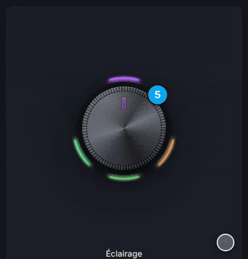
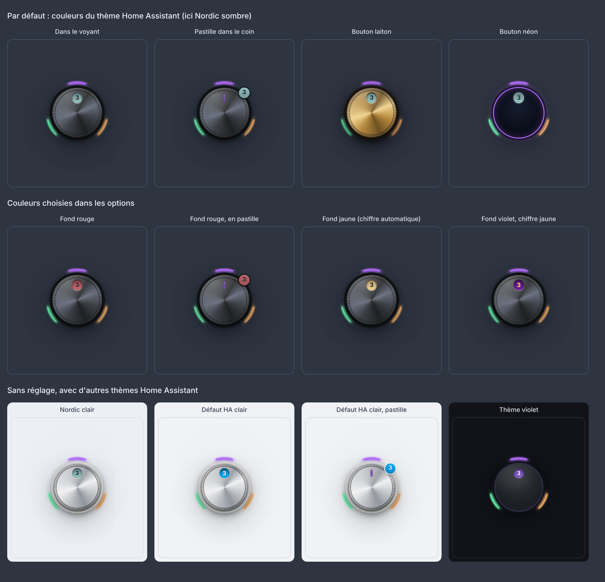
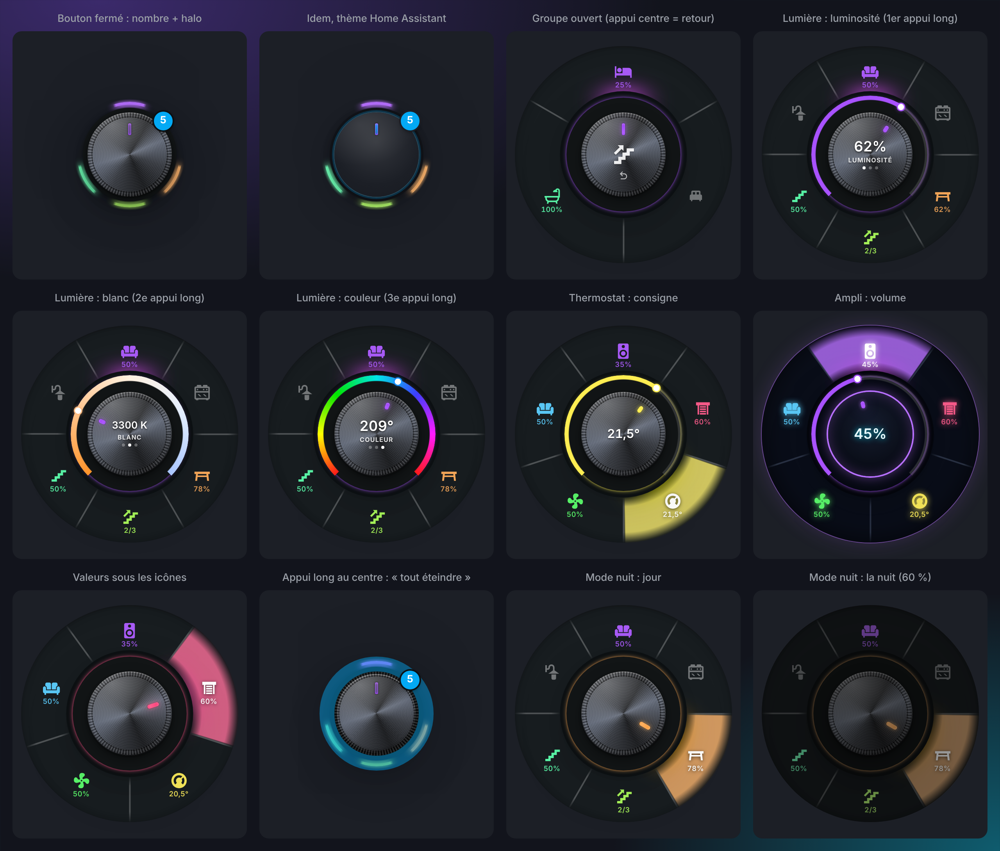
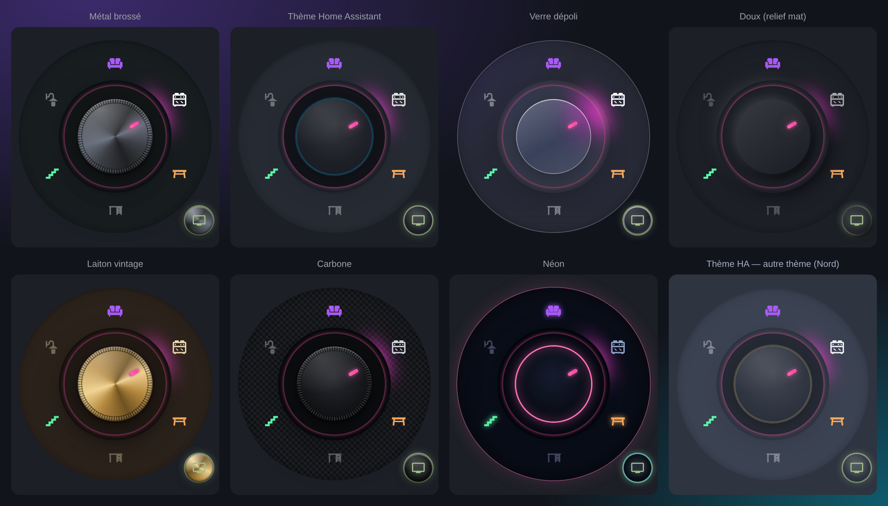
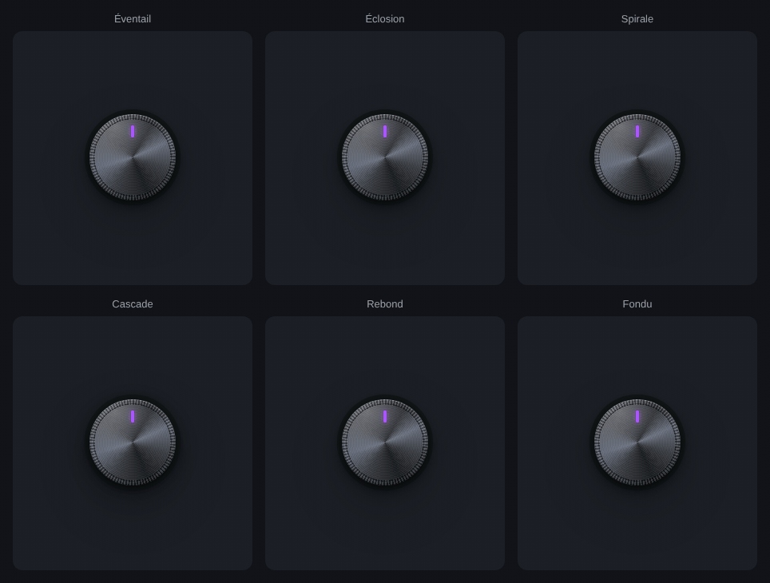
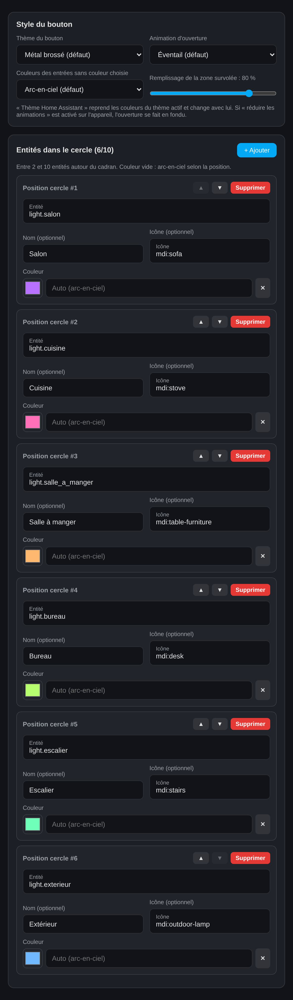
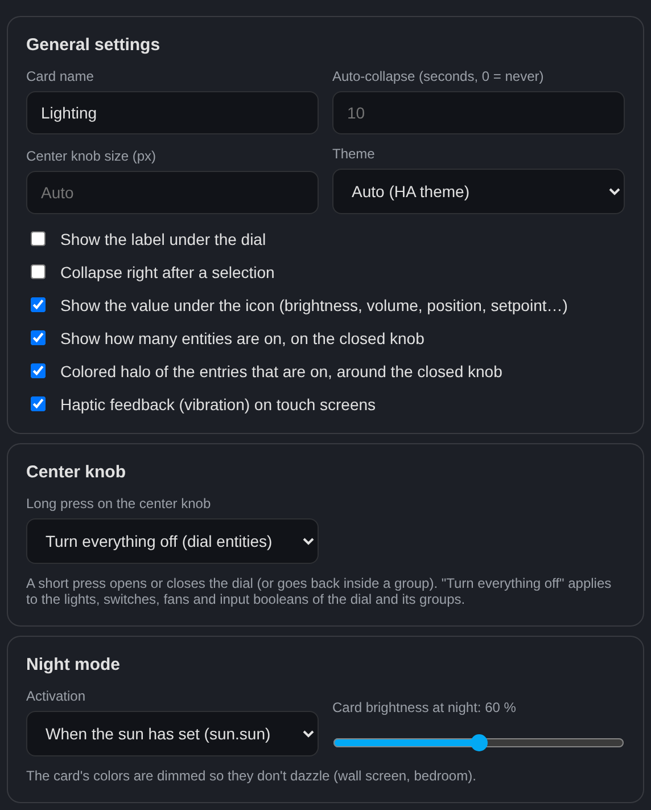

# Radial Selector Card

Sélecteur rotatif pour les tableaux de bord Home Assistant : vos lumières et appareils autour d'un bouton à tourner, avec variateur, groupes, zones tactiles, boutons de coin, thèmes et animations.

*Rotary selector card for Home Assistant dashboards — [English below](#english).*

[](https://my.home-assistant.io/redirect/hacs_repository/?owner=benshoesweb&repository=radial-selector-card&category=plugin)
[](https://github.com/benshoesweb/radial-selector-card/actions/workflows/validate.yml)
[](https://github.com/benshoesweb/radial-selector-card/actions/workflows/tests.yml)



## Fonctionnalités

- **Cercle de 2 à 10 entrées** (lumières, prises, scènes, boutons…), couleur au choix par entrée ou arc-en-ciel.
- **Groupes** : une entrée peut ouvrir un sous-cercle (ex. « Étage » → chambres, salle de bain). Appui sur le bouton central = retour.
- **Molette à l'appui long**, en tournant autour du bouton (¾ de tour) ou à la molette de la souris :
  - lumières : luminosité, puis **blanc** et **couleur** par appuis longs successifs ;
  - ampli / TV : volume · volets : position · thermostat : consigne · ventilateur : vitesse · `input_number` : valeur.
- **Valeur sous l'icône** : 50 %, 20,5°, 35 %, « 2/3 » pour un groupe…
- **Appui long sur le bouton central** : tout éteindre, ouvrir une pop-up, une vue ou activer une scène.
- **Bouton fermé** : le voyant devient un petit bouton enfoncé où s'incruste le nombre d'entités allumées (ou une pastille dans le coin, au choix), aux couleurs du thème Home Assistant ou à celles de votre choix, et un halo coloré entoure le bouton.
- **Zones tactiles** : un secteur par entrée, qui s'éclaire sous la souris ou le doigt.
- **Boutons de coin** (jusqu'à 4) et **ligne de boutons** : pop-up Bubble Card, vue, appareil, avec voyant d'état.
- **7 thèmes** (métal, thème Home Assistant, verre, doux, laiton, carbone, néon) et **7 animations d'ouverture**.
- **Mode nuit**, **retour haptique** sur tablette / téléphone, écran tactile, souris et clavier.
- **Bouton rotatif physique** (Zigbee2MQTT, ZHA, Matter…) qui pilote les mêmes entrées que la carte, avec le blueprint fourni : [voir plus bas](#bouton-rotatif-physique-jumeau).
- **Suit le thème Home Assistant** : clair ou sombre, bouton, couleurs des entrées et nombre d'entités allumées aux couleurs du thème actif ([voir plus bas](#suivre-le-thème-home-assistant)).
- **Éditeur visuel complet** en français ou en anglais, aux couleurs du thème, qui conserve la disposition (`grid_options`) et la visibilité de la carte.






## Installation

### Marketplace (recommandé)

La carte fait partie du catalogue officiel de HACS, intégré à Home Assistant depuis la version 2026.11 :

- **Home Assistant 2026.11 et plus** : **Paramètres › Marketplace**, cherchez « Radial Selector Card », puis **Télécharger**.
- **Versions précédentes, avec HACS installé** : **HACS**, cherchez « Radial Selector Card », puis **Télécharger**.

Le bouton **Ouvrir dans Home Assistant** ci-dessus mène directement à la carte. La ressource du tableau de bord est ajoutée automatiquement, et les nouvelles versions sont proposées en mise à jour.

Compatibilité : testée avec Home Assistant 2026.11. Le blueprint du bouton physique demande Home Assistant 2024.10 ou plus.

### Manuelle

1. Téléchargez `radial-selector-card.js` depuis la [dernière release](https://github.com/benshoesweb/radial-selector-card/releases/latest).
2. Copiez-le dans `/config/www/`.
3. **Paramètres › Tableaux de bord › ⋮ › Ressources** : ajoutez `/local/radial-selector-card.js` (module JavaScript).

## Utilisation

| Geste | Effet |
|---|---|
| Appui sur le bouton central | ouvre / ferme le cercle (dans un groupe : retour) |
| Appui long sur le bouton central | `center_hold_action` (tout éteindre, pop-up, vue, scène…) |
| Appui sur une entrée | allume / éteint (ou ouvre le groupe) |
| Appui long sur une entrée, puis tourner | luminosité, volume, position, consigne, vitesse… |
| 2e et 3e appuis longs (lumière couleur, moins de 3 s après) | blanc (kelvins), puis couleur |
| Appui long sur un groupe sans entité | éteint ce qui est allumé, sinon allume tout le groupe |
| Molette de la souris sur une entrée | règle la valeur cran par cran |
| Clavier | Tab, flèches pour se déplacer, Entrée / Espace pour activer, Échap pour revenir |

## Configuration

Tout se règle dans l'éditeur visuel. Exemple en YAML :

```yaml
type: custom:radial-selector-card
name: Éclairage
knob_theme: ha
open_animation: bloom
center_hold_action:
  action: all_off
night_mode: sun
items:
  - entity: light.salon
    icon: mdi:sofa
  - entity: light.cuisine
    icon: mdi:stove
    color: "#00bcd4"
  - entity: light.salle_a_manger
    icon: mdi:table-furniture
  - name: Étage
    icon: mdi:stairs-up
    items:
      - entity: light.chambre
        icon: mdi:bed
      - entity: light.salle_de_bain
        icon: mdi:shower
  - entity: media_player.ampli
    icon: mdi:speaker
  - entity: climate.salon
    icon: mdi:thermostat
extra_buttons:
  - icon: mdi:television
    entity: media_player.tv
    popup: "#tv-salon"
```

| Option | Valeurs | Défaut |
|---|---|---|
| `name` | nom de la carte : en titre en haut (`show_title`) ou sous le cercle fermé (`show_label`) | aucun |
| `show_title` | affiche le nom en titre en haut de la carte, toujours visible, avec le titre standard des cartes Home Assistant (il suit le thème : `--ha-card-header-font-size`, `--ha-card-header-color`…) | `false` |
| `items` | 2 à 10 entrées : `entity`, `name` (sinon le nom affiché par Home Assistant), `icon`, `color`, `tap_action`, `hold_action`, `dimmer`, `items` (groupe, 10 max) | — |
| `extra_buttons` | 4 max : `entity`, `name`, `icon`, `position`, `style` (`metal` / `tile`), `popup`, `tap_action`, `hold_action`, `color`, `off_color`, `background` | — |
| `row_items` | boutons sous le cercle (mêmes clés que `extra_buttons`, sans `position`) | — |
| `center_hold_action` | `all_off`, ou une action : `navigate` (`#pop-up` ou vue), `perform-action` (ex. `scene.turn_on`), `more-info`, `url` | aucune |
| `dimmer` | `false` : pas de molette ; `true` : molette forcée (lumière) — aussi par entrée | auto |
| `show_brightness` | valeur sous l'icône (%, volume, position, consigne…) | `true` |
| `show_count` | nombre d'entités allumées sur le bouton fermé | `true` |
| `count_position` | `knob` : incrusté dans le voyant du bouton ; `badge` : pastille dans le coin | `knob` |
| `count_background` | couleur CSS du fond du nombre | couleur principale du thème HA |
| `count_color` | couleur CSS du chiffre | texte du thème HA ; noir ou blanc s'il est peu lisible, ou si seul le fond est choisi |
| `show_halo` | halo coloré des entrées allumées autour du bouton fermé | `true` |
| `haptics` | retour haptique au doigt | `true` |
| `night_mode` | `sun` (soleil couché), `entity` (avec `night_entity`), `always` | désactivé |
| `night_level` | 10 à 100 : luminosité de la carte la nuit | `60` |
| `sync_entity` | aide `input_text` ou `input_select` partagée avec un bouton physique ([blueprint](#bouton-rotatif-physique-jumeau)) | aucune |
| `sync_open` | la carte s'ouvre quand on tourne le bouton physique | `true` |
| `sync_from_card` | un appui sur une entrée de la carte la fait piloter par le bouton | `true` |
| `knob_theme` | `metal`, `ha` (suit le thème actif), `glass`, `neumorph`, `brass`, `carbon`, `neon` | `metal` |
| `open_animation` | `fan`, `bloom`, `spiral`, `cascade`, `pop`, `fade`, `none` | `fan` |
| `palette` | `rainbow`, `theme` (couleur principale du thème HA) | `rainbow` |
| `zone_opacity` | 0 à 100 : remplissage de la zone survolée | `80` |
| `auto_close` | secondes avant réduction (0 = jamais) | `10` |
| `card_style` | `border_only`, `standard`, `background_only`, `transparent` | `border_only` |
| `card_background`, `card_border_color` | couleurs CSS | thème |
| `theme` | `auto`, `light`, `dark` | `auto` |
| `size` | diamètre du bouton central en px | auto |
| `show_label` | libellé sous le cercle : nom de la carte (cercle fermé, sans titre), entrée survolée ou choisie (cercle ouvert) | `false` |
| `close_on_select` | réduit le cercle juste après une sélection | `false` |

L'action `all_off` (bouton central, boutons de coin ou ligne de boutons) éteint les lumières, prises, ventilateurs et `input_boolean` allumés du cercle et de ses groupes.

## Suivre le thème Home Assistant

Avec ces réglages, toute la carte change avec votre thème, en clair comme en sombre, sans recharger la page :

| Dans l'éditeur | En YAML | Effet |
|---|---|---|
| Thème : **Auto (thème HA)** | `theme: auto` (défaut) | clair ou sombre comme le thème |
| Thème du bouton : **Thème Home Assistant** | `knob_theme: ha` | bouton, couronne et voyant aux couleurs du thème |
| Couleurs des entrées : **Couleur principale du thème HA** | `palette: theme` | entrées sans couleur choisie à la couleur principale du thème |
| Fond du nombre et Couleur du chiffre : laissés sur **Thème HA** | sans `count_background` ni `count_color` | nombre d'entités allumées aux couleurs du thème, chiffre toujours lisible |

Le fond et le contour de la carte suivent toujours le thème (sauf couleur choisie dans « Apparence de la carte »), de même que l'éditeur. Les couleurs choisies à la main (`color`, `count_background`…) restent prioritaires. Les six autres thèmes du bouton (métal, verre, doux, laiton, carbone, néon) gardent leur matière et n'adaptent que leurs versions claire et sombre.



## Bouton rotatif physique (jumeau)

Le blueprint [`radial_knob_twin.yaml`](blueprints/radial_knob_twin.yaml) transforme un bouton rotatif Zigbee en « jumeau » de la carte :

| Geste sur le bouton | Effet |
|---|---|
| Tourner | entrée suivante / précédente (la carte s'ouvre et la pointe) |
| Appuyer | allume / éteint l'entrée choisie (scène, bouton, serrure, lecture / pause…) |
| Appuyer en tournant, ou double / triple appui selon le modèle | luminosité, volume, position, consigne, vitesse, valeur |
| Mode réglage (optionnel) | pour les boutons qui ne savent que tourner : un geste bascule la rotation entre « choisir » et « régler » |
| Geste « tout éteindre » (optionnel) | éteint les lumières, prises, ventilateurs et `input_boolean` du cercle |

Modèles reconnus d'office : Tuya / Moes / Girier (Zigbee2MQTT, modes « event » et « command »), IKEA Symfonisk 1re génération (Zigbee2MQTT et ZHA), Philips Hue Tap Dial (Zigbee2MQTT). Pour les autres, ajoutez les noms d'actions de votre bouton dans « Actions personnalisées ». Sources possibles : sujet MQTT de Zigbee2MQTT, entité événement (`event.*`, Matter, Hue…) ou capteur d'action, appareil ZHA, ou l'événement `radial_selector_knob` envoyé par n'importe quelle automatisation.

1. Créez une aide **Texte** (Paramètres › Appareils et services › Entrées), par exemple `input_text.bouton_salon`.
2. Importez le blueprint :
   [](https://my.home-assistant.io/redirect/blueprint_import/?blueprint_url=https%3A%2F%2Fgithub.com%2Fbenshoesweb%2Fradial-selector-card%2Fblob%2Fmain%2Fblueprints%2Fradial_knob_twin.yaml)
3. Créez l'automatisation : entités du cercle (dans le même ordre que la carte), l'aide, puis le bouton.
4. Dans la carte, réglez **Bouton rotatif physique › Synchroniser avec** sur la même aide :

```yaml
type: custom:radial-selector-card
sync_entity: input_text.bouton_salon
items:
  - entity: light.salon
  - entity: light.cuisine
  - entity: media_player.ampli
```

Un appui sur une entrée de la carte la fait piloter ensuite par le bouton. Depuis une autre automatisation (télécommande, bouton sans fil…) :

```yaml
# action d'une automatisation ou d'un script
- event: radial_selector_knob
  event_data:
    helper: input_text.bouton_salon   # facultatif : sans lui, tous les boutons jumeaux réagissent
    command: next                     # next, previous, toggle, up, down, adjust, all_off, select
    # entity: light.cuisine           # avec command: select
```

## English

A rotary selector for Home Assistant dashboards: lights and devices around a knob you turn, with a rotary control, groups, touch zones, corner buttons, themes and opening animations. The card and its visual editor follow Home Assistant's language (English or French).

- **2 to 10 entries** around the dial; an entry with its own `items` opens a **sub-dial (group)** — tap the center knob to go back.
- **Long press + turn** (or mouse wheel): brightness, then **white** and **color** on successive long presses for color lights; volume (`media_player`), position (`cover`), setpoint (`climate`), speed (`fan`), value (`input_number` / `number`).
- **Long press on the center knob** (`center_hold_action`): `all_off`, pop-up, view, scene…
- **Closed knob**: the indicator becomes a small recessed button with the number of entities on inlaid in it (`show_count`; `count_position: badge` for a corner badge instead), in the Home Assistant theme's colors or your own (`count_background`, `count_color`), and a colored halo (`show_halo`).
- **Night mode** (`night_mode: sun | entity | always`, `night_level`), **haptic feedback** on touch screens (`haptics`).
- **Physical knob twin**: with the [`radial_knob_twin.yaml`](https://my.home-assistant.io/redirect/blueprint_import/?blueprint_url=https%3A%2F%2Fgithub.com%2Fbenshoesweb%2Fradial-selector-card%2Fblob%2Fmain%2Fblueprints%2Fradial_knob_twin.yaml) blueprint, a Zigbee rotary knob (Zigbee2MQTT, ZHA, event entities…) turns through the same entries (the card opens and points at them), toggles on press and adjusts brightness, volume, position… on press + turn. Share a text helper between the blueprint and the card (`sync_entity`); `sync_open: false` keeps the card closed, `sync_from_card: false` stops card taps from changing the knob's entry.
- **Card name**: `show_title: true` shows the `name` as a title at the top of the card, always visible, using Home Assistant's standard card title (it follows the theme); `show_label: true` shows a label under the dial (card name when closed and no title, hovered or selected entry when open).
- Corner buttons, a row of buttons, 7 knob themes, 7 opening animations, touch / mouse / keyboard.

- **Follows the Home Assistant theme**: `theme: auto`, `knob_theme: ha` and `palette: theme` make the whole card (knob, ring, indicator, entries, number of entities on) use the active theme's colors, in light and dark mode; the card background and the editor always follow the theme. Hand-picked colors still win.

**Install**: the card is in the official HACS catalog, built into Home Assistant since 2026.11 — **Settings › Marketplace**, search for "Radial Selector Card" (on older versions: **HACS**). The **Open in Home Assistant** button above leads straight to it. Then add the card from the dashboard editor: everything can be configured visually. The options table above lists the YAML keys. Tested with Home Assistant 2026.11; the physical knob blueprint needs 2024.10 or later.



## Développement

```bash
npm ci
npx playwright install chromium
npm test          # 237 vérifications dans Chrome : souris, doigt, clavier, molette, groupes, éditeur…
```

Les tests tournent aussi sur GitHub à chaque modification (workflow **Tests**). Historique : [CHANGELOG.md](CHANGELOG.md).

## Publier une nouvelle version

1. Modifiez `dist/radial-selector-card.js` et notez le changement dans [CHANGELOG.md](CHANGELOG.md), en français et en anglais, sous « Non publié ».
2. Passez la section « Non publié » au numéro de version (et `package.json`), puis fusionnez dans `main`.
3. **Ensuite seulement**, créez la release GitHub `vX.Y.Z` sur `main` (ou `./scripts/release.sh vX.Y.Z`) : le tag contient alors le bon CHANGELOG.

Le workflow **Release** joint le fichier de la carte à la release ; la Marketplace la propose ensuite en mise à jour.
