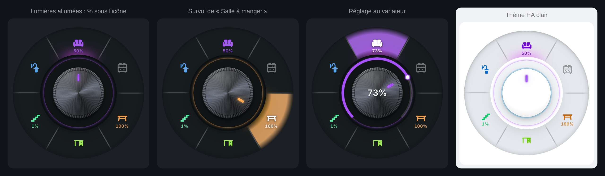

# Radial Selector Card

Sélecteur rotatif pour les tableaux de bord Home Assistant : vos lumières et appareils autour d'un bouton à tourner, avec variateur, zones tactiles, boutons de coin, thèmes et animations.

[](https://my.home-assistant.io/redirect/hacs_repository/?owner=benshoesweb&repository=radial-selector-card&category=plugin)
[](https://github.com/benshoesweb/radial-selector-card/actions/workflows/validate.yml)


## Fonctionnalités

- **Cercle de 2 à 10 entrées** (lumières, prises, scènes, boutons…), couleur au choix par entrée ou arc-en-ciel.
- **Zones tactiles** : un secteur par entrée, séparé par un trait ; il se remplit de la couleur de l'entrée sous la souris ou le doigt. Appui, appui long et variateur fonctionnent dans toute la zone.
- **Variateur** : appui long sur une lumière variable, puis on tourne autour du bouton (arc de ¾ de tour) ; molette de la souris ; pourcentage affiché sous l'icône des lumières allumées.
- **Boutons de coin** (jusqu'à 4) : pop-up Bubble Card, vue, appareil, avec voyant d'état.
- **Ligne de boutons** sous le cercle.
- **7 thèmes** : métal brossé, thème Home Assistant (suit le thème actif), verre dépoli, doux, laiton, carbone, néon.
- **7 animations d'ouverture** : éventail, éclosion, spirale, cascade, rebond, fondu, aucune.
- **Éditeur visuel complet**, qui conserve la disposition (`grid_options`) et la visibilité de la carte.
- Écran tactile, souris et clavier ; réduction automatique du cercle.





## Installation

### Marketplace (Home Assistant 2026.11 et plus) ou HACS

Cliquez sur le bouton **Ouvrir dans Home Assistant** ci-dessus, ou ajoutez ce dépôt comme dépôt personnalisé, catégorie **Dashboard** :
`https://github.com/benshoesweb/radial-selector-card`

La ressource du tableau de bord est ajoutée automatiquement.

### Manuelle

1. Téléchargez `radial-selector-card.js` depuis la [dernière release](https://github.com/benshoesweb/radial-selector-card/releases/latest).
2. Copiez-le dans `/config/www/`.
3. **Paramètres › Tableaux de bord › ⋮ › Ressources** : ajoutez `/local/radial-selector-card.js` (module JavaScript).

## Configuration

Tout se règle dans l'éditeur visuel. Exemple en YAML :

```yaml
type: custom:radial-selector-card
name: Éclairage
knob_theme: ha
open_animation: bloom
items:
  - entity: light.salon
    icon: mdi:sofa
  - entity: light.cuisine
    icon: mdi:stove
    color: "#00bcd4"
  - entity: light.salle_a_manger
    icon: mdi:table-furniture
  - entity: light.bureau
    icon: mdi:desk
extra_buttons:
  - icon: mdi:television
    entity: media_player.tv
    popup: "#tv-salon"
  - icon: mdi:cctv
    position: bottom-left
    tap_action:
      action: navigate
      navigation_path: /lovelace/cameras
```

| Option | Valeurs | Défaut |
|---|---|---|
| `items` | 2 à 10 entrées : `entity`, `name`, `icon`, `color`, `tap_action`, `hold_action`, `dimmer` | — |
| `extra_buttons` | 4 max : `entity`, `name`, `icon`, `position`, `style` (`metal` / `tile`), `popup`, `tap_action`, `hold_action`, `color`, `off_color`, `background` | — |
| `row_items` | boutons sous le cercle (mêmes clés que `extra_buttons`, sans `position`) | — |
| `knob_theme` | `metal`, `ha`, `glass`, `neumorph`, `brass`, `carbon`, `neon` | `metal` |
| `open_animation` | `fan`, `bloom`, `spiral`, `cascade`, `pop`, `fade`, `none` | `fan` |
| `palette` | `rainbow`, `theme` (couleur principale du thème HA) | `rainbow` |
| `zone_opacity` | 0 à 100 : remplissage de la zone survolée | `80` |
| `show_brightness` | % sous les lumières variables allumées | `true` |
| `auto_close` | secondes avant réduction (0 = jamais) | `10` |
| `card_style` | `border_only`, `standard`, `background_only`, `transparent` | `border_only` |
| `card_background`, `card_border_color` | couleurs CSS | thème |
| `theme` | `auto`, `light`, `dark` | `auto` |
| `size` | diamètre du bouton central en px | auto |
| `show_label`, `close_on_select` | `true` / `false` | `false` |


## Publier une nouvelle version

Modifiez `dist/radial-selector-card.js`, puis :

```bash
./scripts/release.sh v1.1.0
```

Le workflow **Release** crée la release GitHub avec le fichier de la carte ; la Marketplace la propose ensuite en mise à jour (comptez quelques heures).
