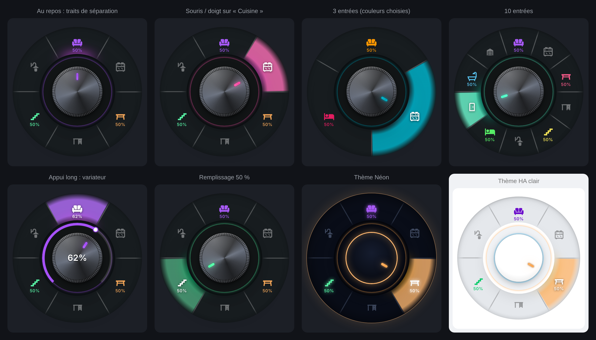
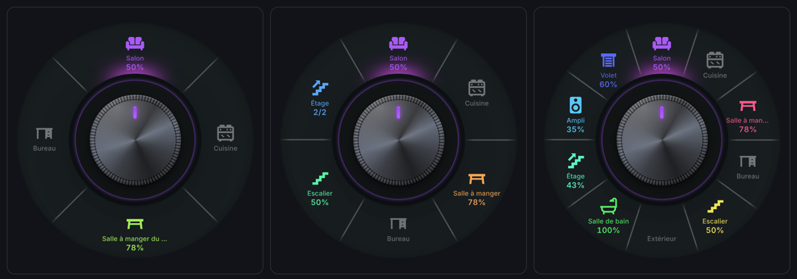
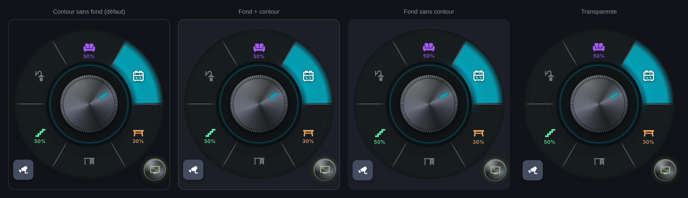

# Radial Selector Card

A rotary selector for Home Assistant dashboards: your lights and devices around a knob you turn, with a dimmer, groups, touch zones, corner buttons, themes and animations.

*Sélecteur rotatif pour les tableaux de bord Home Assistant : vos lumières et appareils autour d'un bouton à tourner.*

**[English](#english)** · **[Français](#français)**

[](https://my.home-assistant.io/redirect/hacs_repository/?owner=benshoesweb&repository=radial-selector-card&category=plugin)
[](https://github.com/benshoesweb/radial-selector-card/actions/workflows/validate.yml)
[](https://github.com/benshoesweb/radial-selector-card/actions/workflows/tests.yml)


---

## English

The card and its visual editor follow Home Assistant's language (English or French).

### Features

- **A dial of 2 to 10 entries** (lights, plugs, scenes, buttons…), each with its own color or a rainbow.
- **Groups**: an entry can open a sub-dial (e.g. "Upstairs" → bedrooms, bathroom). Tap the center knob to go back.
- **Rotary control on long press**, by turning around the knob (¾ turn) or with the mouse wheel:
  - lights: brightness, then **white** and **color** with successive long presses;
  - amplifier / TV: volume · covers: position · thermostat: setpoint · fan: speed · `input_number`: value.
- **Value under the icon**: 50 %, 20.5°, 35 %, "2/3" for a group…
- **Names under the icons** (optional): each entry's and group's name in small under its icon, shortened with "…" when there is no room.
- **Long press on the center knob**: turn everything off, open a pop-up or a view, or activate a scene.
- **Closed knob**: the indicator becomes a small recessed button with the number of entities on inlaid in it (or a corner badge, as you prefer), in the Home Assistant theme's colors or your own, with a colored halo around the knob.
- **Touch zones**: one sector per entry, lit up under the mouse or the finger.
- **Corner buttons** (up to 4) and a **row of buttons**: Bubble Card pop-up, view, device, with a status light.
- **7 knob themes** (metal, Home Assistant theme, glass, soft, brass, carbon, neon) and **7 opening animations**.
- **Night mode**, **haptic feedback** on tablets and phones, touch screen, mouse and keyboard.
- **Physical rotary knob** (Zigbee2MQTT, ZHA, Matter…) driving the same entries as the card, with the included blueprint: [see below](#physical-rotary-knob-twin).
- **Follows the Home Assistant theme**: light or dark, the knob, the entry colors and the number of entities on use the active theme's colors ([see below](#follow-the-home-assistant-theme)).
- **Full visual editor**, in the theme's colors, that keeps the card's layout (`grid_options`) and visibility.






### Installation

#### Marketplace (recommended)

The card is in the official HACS catalog, built into Home Assistant since 2026.11:

- **Home Assistant 2026.11 and later**: **Settings › Marketplace**, search for "Radial Selector Card", then **Download**.
- **Earlier versions, with HACS installed**: **HACS**, search for "Radial Selector Card", then **Download**.

The **Open in Home Assistant** button above leads straight to the card: in the **Marketplace** on Home Assistant 2026.11 and later, in **HACS** on earlier versions. The dashboard resource is added automatically, and new versions are offered as updates.

Compatibility: tested with Home Assistant 2026.11. The physical knob blueprint needs Home Assistant 2024.10 or later.

#### Manual

1. Download `radial-selector-card.js` from the [latest release](https://github.com/benshoesweb/radial-selector-card/releases/latest).
2. Copy it to `/config/www/`.
3. **Settings › Dashboards › ⋮ › Resources**: add `/local/radial-selector-card.js` (JavaScript module).

### Usage

| Gesture | Effect |
|---|---|
| Tap the center knob | opens / closes the dial (in a group: back) |
| Long press the center knob | `center_hold_action` (turn everything off, pop-up, view, scene…) |
| Tap an entry | turns it on / off (or opens the group) |
| Long press an entry, then turn | brightness, volume, position, setpoint, speed… |
| 2nd and 3rd long press (color light, within 3 s) | white (kelvin), then color |
| Long press a group without an entity | turns off what is on, otherwise turns the whole group on |
| Mouse wheel on an entry | adjusts the value step by step |
| Keyboard | Tab and arrows to move, Enter / Space to activate, Escape to go back |

### Configuration

Everything can be set in the visual editor. YAML example:

```yaml
type: custom:radial-selector-card
name: Lighting
knob_theme: ha
open_animation: bloom
center_hold_action:
  action: all_off
night_mode: sun
items:
  - entity: light.living_room
    icon: mdi:sofa
  - entity: light.kitchen
    icon: mdi:stove
    color: "#00bcd4"
  - entity: light.dining_room
    icon: mdi:table-furniture
  - name: Upstairs
    icon: mdi:stairs-up
    items:
      - entity: light.bedroom
        icon: mdi:bed
      - entity: light.bathroom
        icon: mdi:shower
  - entity: media_player.amplifier
    icon: mdi:speaker
  - entity: climate.living_room
    icon: mdi:thermostat
extra_buttons:
  - icon: mdi:television
    entity: media_player.tv
    popup: "#tv-living-room"
```

| Option | Values | Default |
|---|---|---|
| `name` | card name: as a title at the top (`show_title`) or under the closed dial (`show_label`) | none |
| `show_title` | shows the name as a title at the top of the card, always visible, using Home Assistant's standard card title (it follows the theme: `--ha-card-header-font-size`, `--ha-card-header-color`…) | `false` |
| `items` | 2 to 10 entries: `entity`, `name` (otherwise the name Home Assistant displays), `icon`, `color`, `tap_action`, `hold_action`, `dimmer`, `items` (group, 10 max) | — |
| `extra_buttons` | 4 max: `entity`, `name`, `icon`, `position`, `style` (`metal` / `tile`), `popup`, `tap_action`, `hold_action`, `color`, `off_color`, `background` | — |
| `row_items` | buttons under the dial (same keys as `extra_buttons`, without `position`) | — |
| `center_hold_action` | `all_off`, or an action: `navigate` (`#pop-up` or view), `perform-action` (e.g. `scene.turn_on`), `more-info`, `url` | none |
| `dimmer` | `false`: no rotary control; `true`: forced (light) — also per entry | auto |
| `show_brightness` | value under the icon (%, volume, position, setpoint…) | `true` |
| `show_names` | name in small under each entry's and group's icon: the chosen `name`, otherwise the name Home Assistant displays; the value moves below it | `false` |
| `show_count` | number of entities on, on the closed knob | `true` |
| `count_position` | `knob`: inlaid in the knob's indicator; `badge`: corner badge | `knob` |
| `count_background` | CSS color of the number's background | HA theme's primary color |
| `count_color` | CSS color of the digit | HA theme text; black or white if hard to read, or if only the background is set |
| `show_halo` | colored halo of the entries that are on, around the closed knob | `true` |
| `haptics` | haptic feedback under the finger | `true` |
| `night_mode` | `sun` (after sunset), `entity` (with `night_entity`), `always` | off |
| `night_level` | 10 to 100: card brightness at night | `60` |
| `sync_entity` | `input_text` or `input_select` helper shared with a physical knob ([blueprint](#physical-rotary-knob-twin)) | none |
| `sync_open` | the card opens when the physical knob is turned | `true` |
| `sync_from_card` | tapping an entry in the card makes the knob control it | `true` |
| `knob_theme` | `metal`, `ha` (follows the active theme), `glass`, `neumorph`, `brass`, `carbon`, `neon` | `metal` |
| `open_animation` | `fan`, `bloom`, `spiral`, `cascade`, `pop`, `fade`, `none` | `fan` |
| `palette` | `rainbow`, `theme` (HA theme's primary color) | `rainbow` |
| `zone_opacity` | 0 to 100: fill of the hovered zone | `80` |
| `auto_close` | seconds before the dial closes (0 = never) | `10` |
| `card_style` | `border_only`, `standard`, `background_only`, `transparent` ([see below](#card-appearance)) | `border_only` |
| `card_background`, `card_border_color` | CSS colors | theme |
| `theme` | `auto`, `light`, `dark` | `auto` |
| `size` | diameter of the center knob in px | auto |
| `show_label` | label under the dial: card name (closed dial, no title), hovered or selected entry (open dial) | `false` |
| `close_on_select` | closes the dial right after a selection | `false` |

The `all_off` action (center knob, corner buttons or row of buttons) turns off the lights, plugs, fans and `input_boolean` that are on in the dial and its groups.

### Follow the Home Assistant theme

With these settings the whole card changes with your theme, in light and dark mode, without reloading the page:

| In the editor | In YAML | Effect |
|---|---|---|
| Theme: **Auto (HA theme)** | `theme: auto` (default) | light or dark like the theme |
| Knob theme: **Home Assistant theme** | `knob_theme: ha` | knob, ring and indicator in the theme's colors |
| Colors of entries without a chosen color: **HA theme primary color** | `palette: theme` | entries without a chosen color use the theme's primary color |
| Number background and Digit color: left on **HA theme** | no `count_background` nor `count_color` | number of entities on in the theme's colors, digit always readable |

The card background and border always follow the theme (unless you pick a color in "Card appearance"), and so does the editor. Hand-picked colors (`color`, `count_background`…) still win. The six other knob themes (metal, glass, soft, brass, carbon, neon) keep their material and only adapt their light and dark versions.


### Card appearance

In the editor (**Card appearance**), choose the card's background and border: border without background (default), background + border, background without border, or **transparent**, to place the knob straight on the dashboard background. Colors can be picked with `card_background` and `card_border_color`; otherwise the theme's colors apply.



### Physical rotary knob (twin)

The [`radial_knob_twin.yaml`](blueprints/radial_knob_twin.yaml) blueprint turns a Zigbee rotary knob into a "twin" of the card:

| Gesture on the knob | Effect |
|---|---|
| Turn | next / previous entry (the card opens and points at it) |
| Press | turns the selected entry on / off (scene, button, lock, play / pause…) |
| Press while turning, or double / triple press depending on the model | brightness, volume, position, setpoint, speed, value |
| Adjust mode (optional) | for knobs that can only turn: a gesture switches turning between "choose" and "adjust" |
| "Turn everything off" gesture (optional) | turns off the dial's lights, plugs, fans and `input_boolean` |

Supported out of the box: Tuya / Moes / Girier (Zigbee2MQTT, "event" and "command" modes), IKEA Symfonisk 1st generation (Zigbee2MQTT and ZHA), Philips Hue Tap Dial (Zigbee2MQTT). For other models, add your knob's action names under "Custom actions". Possible sources: a Zigbee2MQTT MQTT topic, an event entity (`event.*`, Matter, Hue…) or an action sensor, a ZHA device, or the `radial_selector_knob` event sent by any automation.

1. Create a **Text** helper (Settings › Devices & services › Helpers), for example `input_text.living_room_knob`.
2. Import the blueprint:
   [](https://my.home-assistant.io/redirect/blueprint_import/?blueprint_url=https%3A%2F%2Fgithub.com%2Fbenshoesweb%2Fradial-selector-card%2Fblob%2Fmain%2Fblueprints%2Fradial_knob_twin.yaml)
3. Create the automation: the dial's entities (in the same order as the card), the helper, then the knob.
4. In the card, set **Physical rotary knob › Sync with** (text or dropdown helper) to the same helper:

```yaml
type: custom:radial-selector-card
sync_entity: input_text.living_room_knob
items:
  - entity: light.living_room
  - entity: light.kitchen
  - entity: media_player.amplifier
```

Tapping an entry in the card then makes the knob control it. From another automation (remote, wireless button…):

```yaml
# action of an automation or a script
- event: radial_selector_knob
  event_data:
    helper: input_text.living_room_knob   # optional: without it, every knob twin reacts
    command: next                         # next, previous, toggle, up, down, adjust, all_off, select
    # entity: light.kitchen               # with command: select
```

### Development

```bash
npm ci
npx playwright install chromium
npm test          # 250 checks in Chrome: mouse, finger, keyboard, wheel, groups, editor…
```

The tests also run on GitHub on every change (**Tests** workflow). History: [CHANGELOG.md](CHANGELOG.md).

### Publishing a new version

1. Edit `dist/radial-selector-card.js` and describe the change in [CHANGELOG.md](CHANGELOG.md), in French and in English, under "Non publié" (unreleased).
2. Rename the "Non publié" section to the version number (and update `package.json`), then merge into `main`.
3. **Only then**, create the GitHub release `vX.Y.Z` on `main` (or `./scripts/release.sh vX.Y.Z`): the tag then contains the right CHANGELOG.

The **Release** workflow attaches the card file to the release; the Marketplace then offers it as an update.

---

## Français

La carte et son éditeur visuel suivent la langue de Home Assistant (français ou anglais).

### Fonctionnalités

- **Cercle de 2 à 10 entrées** (lumières, prises, scènes, boutons…), couleur au choix par entrée ou arc-en-ciel.
- **Groupes** : une entrée peut ouvrir un sous-cercle (ex. « Étage » → chambres, salle de bain). Appui sur le bouton central = retour.
- **Molette à l'appui long**, en tournant autour du bouton (¾ de tour) ou à la molette de la souris :
  - lumières : luminosité, puis **blanc** et **couleur** par appuis longs successifs ;
  - ampli / TV : volume · volets : position · thermostat : consigne · ventilateur : vitesse · `input_number` : valeur.
- **Valeur sous l'icône** : 50 %, 20,5°, 35 %, « 2/3 » pour un groupe…
- **Noms sous les icônes** (en option) : le nom de chaque entrée et de chaque groupe en petit sous son icône, raccourci avec « … » s'il manque de place.
- **Appui long sur le bouton central** : tout éteindre, ouvrir une pop-up, une vue ou activer une scène.
- **Bouton fermé** : le voyant devient un petit bouton enfoncé où s'incruste le nombre d'entités allumées (ou une pastille dans le coin, au choix), aux couleurs du thème Home Assistant ou à celles de votre choix, et un halo coloré entoure le bouton.
- **Zones tactiles** : un secteur par entrée, qui s'éclaire sous la souris ou le doigt.
- **Boutons de coin** (jusqu'à 4) et **ligne de boutons** : pop-up Bubble Card, vue, appareil, avec voyant d'état.
- **7 thèmes** (métal, thème Home Assistant, verre, doux, laiton, carbone, néon) et **7 animations d'ouverture**.
- **Mode nuit**, **retour haptique** sur tablette / téléphone, écran tactile, souris et clavier.
- **Bouton rotatif physique** (Zigbee2MQTT, ZHA, Matter…) qui pilote les mêmes entrées que la carte, avec le blueprint fourni : [voir plus bas](#bouton-rotatif-physique-jumeau).
- **Suit le thème Home Assistant** : clair ou sombre, bouton, couleurs des entrées et nombre d'entités allumées aux couleurs du thème actif ([voir plus bas](#suivre-le-thème-home-assistant)).
- **Éditeur visuel complet**, aux couleurs du thème, qui conserve la disposition (`grid_options`) et la visibilité de la carte.


### Installation

#### Marketplace (recommandé)

La carte fait partie du catalogue officiel de HACS, intégré à Home Assistant depuis la version 2026.11 :

- **Home Assistant 2026.11 et plus** : **Paramètres › Marketplace**, cherchez « Radial Selector Card », puis **Télécharger**.
- **Versions précédentes, avec HACS installé** : **HACS**, cherchez « Radial Selector Card », puis **Télécharger**.

Le bouton **Open in Home Assistant** en haut de la page mène directement à la carte : dans la **Marketplace** avec Home Assistant 2026.11 et plus, dans **HACS** avec les versions précédentes. La ressource du tableau de bord est ajoutée automatiquement, et les nouvelles versions sont proposées en mise à jour.

Compatibilité : testée avec Home Assistant 2026.11. Le blueprint du bouton physique demande Home Assistant 2024.10 ou plus.

#### Manuelle

1. Téléchargez `radial-selector-card.js` depuis la [dernière release](https://github.com/benshoesweb/radial-selector-card/releases/latest).
2. Copiez-le dans `/config/www/`.
3. **Paramètres › Tableaux de bord › ⋮ › Ressources** : ajoutez `/local/radial-selector-card.js` (module JavaScript).

### Utilisation

| Geste | Effet |
|---|---|
| Appui sur le bouton central | ouvre / ferme le cercle (dans un groupe : retour) |
| Appui long sur le bouton central | `center_hold_action` (tout éteindre, pop-up, vue, scène…) |
| Appui sur une entrée | allume / éteint (ou ouvre le groupe) |
| Appui long sur une entrée, puis tourner | luminosité, volume, position, consigne, vitesse… |
| 2e et 3e appuis longs (lumière couleur, moins de 3 s après) | blanc (kelvins), puis couleur |
| Appui long sur un groupe sans entité | éteint ce qui est allumé, sinon allume tout le groupe |
| Molette de la souris sur une entrée | règle la valeur cran par cran |
| Clavier | Tab et flèches pour se déplacer, Entrée / Espace pour activer, Échap pour revenir |

### Configuration

Tout se règle dans l'éditeur visuel. Exemple en YAML :

```yaml
type: custom:radial-selector-card
name: Éclairage
knob_theme: ha
open_animation: bloom
center_hold_action:
  action: all_off
night_mode: sun
items:
  - entity: light.salon
    icon: mdi:sofa
  - entity: light.cuisine
    icon: mdi:stove
    color: "#00bcd4"
  - entity: light.salle_a_manger
    icon: mdi:table-furniture
  - name: Étage
    icon: mdi:stairs-up
    items:
      - entity: light.chambre
        icon: mdi:bed
      - entity: light.salle_de_bain
        icon: mdi:shower
  - entity: media_player.ampli
    icon: mdi:speaker
  - entity: climate.salon
    icon: mdi:thermostat
extra_buttons:
  - icon: mdi:television
    entity: media_player.tv
    popup: "#tv-salon"
```

| Option | Valeurs | Défaut |
|---|---|---|
| `name` | nom de la carte : en titre en haut (`show_title`) ou sous le cercle fermé (`show_label`) | aucun |
| `show_title` | affiche le nom en titre en haut de la carte, toujours visible, avec le titre standard des cartes Home Assistant (il suit le thème : `--ha-card-header-font-size`, `--ha-card-header-color`…) | `false` |
| `items` | 2 à 10 entrées : `entity`, `name` (sinon le nom affiché par Home Assistant), `icon`, `color`, `tap_action`, `hold_action`, `dimmer`, `items` (groupe, 10 max) | — |
| `extra_buttons` | 4 max : `entity`, `name`, `icon`, `position`, `style` (`metal` / `tile`), `popup`, `tap_action`, `hold_action`, `color`, `off_color`, `background` | — |
| `row_items` | boutons sous le cercle (mêmes clés que `extra_buttons`, sans `position`) | — |
| `center_hold_action` | `all_off`, ou une action : `navigate` (`#pop-up` ou vue), `perform-action` (ex. `scene.turn_on`), `more-info`, `url` | aucune |
| `dimmer` | `false` : pas de molette ; `true` : molette forcée (lumière) — aussi par entrée | auto |
| `show_brightness` | valeur sous l'icône (%, volume, position, consigne…) | `true` |
| `show_names` | nom en petit sous l'icône de chaque entrée et groupe : le `name` choisi, sinon le nom affiché par Home Assistant ; la valeur passe en dessous | `false` |
| `show_count` | nombre d'entités allumées sur le bouton fermé | `true` |
| `count_position` | `knob` : incrusté dans le voyant du bouton ; `badge` : pastille dans le coin | `knob` |
| `count_background` | couleur CSS du fond du nombre | couleur principale du thème HA |
| `count_color` | couleur CSS du chiffre | texte du thème HA ; noir ou blanc s'il est peu lisible, ou si seul le fond est choisi |
| `show_halo` | halo coloré des entrées allumées autour du bouton fermé | `true` |
| `haptics` | retour haptique au doigt | `true` |
| `night_mode` | `sun` (soleil couché), `entity` (avec `night_entity`), `always` | désactivé |
| `night_level` | 10 à 100 : luminosité de la carte la nuit | `60` |
| `sync_entity` | aide `input_text` ou `input_select` partagée avec un bouton physique ([blueprint](#bouton-rotatif-physique-jumeau)) | aucune |
| `sync_open` | la carte s'ouvre quand on tourne le bouton physique | `true` |
| `sync_from_card` | un appui sur une entrée de la carte la fait piloter par le bouton | `true` |
| `knob_theme` | `metal`, `ha` (suit le thème actif), `glass`, `neumorph`, `brass`, `carbon`, `neon` | `metal` |
| `open_animation` | `fan`, `bloom`, `spiral`, `cascade`, `pop`, `fade`, `none` | `fan` |
| `palette` | `rainbow`, `theme` (couleur principale du thème HA) | `rainbow` |
| `zone_opacity` | 0 à 100 : remplissage de la zone survolée | `80` |
| `auto_close` | secondes avant réduction (0 = jamais) | `10` |
| `card_style` | `border_only`, `standard`, `background_only`, `transparent` ([voir plus bas](#apparence-de-la-carte)) | `border_only` |
| `card_background`, `card_border_color` | couleurs CSS | thème |
| `theme` | `auto`, `light`, `dark` | `auto` |
| `size` | diamètre du bouton central en px | auto |
| `show_label` | libellé sous le cercle : nom de la carte (cercle fermé, sans titre), entrée survolée ou choisie (cercle ouvert) | `false` |
| `close_on_select` | réduit le cercle juste après une sélection | `false` |

L'action `all_off` (bouton central, boutons de coin ou ligne de boutons) éteint les lumières, prises, ventilateurs et `input_boolean` allumés du cercle et de ses groupes.

### Suivre le thème Home Assistant

Avec ces réglages, toute la carte change avec votre thème, en clair comme en sombre, sans recharger la page :

| Dans l'éditeur | En YAML | Effet |
|---|---|---|
| Thème : **Auto (thème HA)** | `theme: auto` (défaut) | clair ou sombre comme le thème |
| Thème du bouton : **Thème Home Assistant** | `knob_theme: ha` | bouton, couronne et voyant aux couleurs du thème |
| Couleurs des entrées sans couleur choisie : **Couleur principale du thème HA** | `palette: theme` | entrées sans couleur choisie à la couleur principale du thème |
| Fond du nombre et Couleur du chiffre : laissés sur **Thème HA** | sans `count_background` ni `count_color` | nombre d'entités allumées aux couleurs du thème, chiffre toujours lisible |

Le fond et le contour de la carte suivent toujours le thème (sauf couleur choisie dans « Apparence de la carte »), de même que l'éditeur. Les couleurs choisies à la main (`color`, `count_background`…) restent prioritaires. Les six autres thèmes du bouton (métal, verre, doux, laiton, carbone, néon) gardent leur matière et n'adaptent que leurs versions claire et sombre.


### Apparence de la carte

Dans l'éditeur (**Apparence de la carte**), choisissez le fond et le contour de la carte : contour sans fond (par défaut), fond + contour, fond sans contour ou **transparente**, pour poser le bouton directement sur le fond du tableau de bord. Les couleurs se choisissent avec `card_background` et `card_border_color` ; sinon, celles du thème s'appliquent.


### Bouton rotatif physique (jumeau)

Le blueprint [`radial_knob_twin.yaml`](blueprints/radial_knob_twin.yaml) transforme un bouton rotatif Zigbee en « jumeau » de la carte :

| Geste sur le bouton | Effet |
|---|---|
| Tourner | entrée suivante / précédente (la carte s'ouvre et la pointe) |
| Appuyer | allume / éteint l'entrée choisie (scène, bouton, serrure, lecture / pause…) |
| Appuyer en tournant, ou double / triple appui selon le modèle | luminosité, volume, position, consigne, vitesse, valeur |
| Mode réglage (optionnel) | pour les boutons qui ne savent que tourner : un geste bascule la rotation entre « choisir » et « régler » |
| Geste « tout éteindre » (optionnel) | éteint les lumières, prises, ventilateurs et `input_boolean` du cercle |

Modèles reconnus d'office : Tuya / Moes / Girier (Zigbee2MQTT, modes « event » et « command »), IKEA Symfonisk 1re génération (Zigbee2MQTT et ZHA), Philips Hue Tap Dial (Zigbee2MQTT). Pour les autres, ajoutez les noms d'actions de votre bouton dans « Actions personnalisées ». Sources possibles : sujet MQTT de Zigbee2MQTT, entité événement (`event.*`, Matter, Hue…) ou capteur d'action, appareil ZHA, ou l'événement `radial_selector_knob` envoyé par n'importe quelle automatisation.

1. Créez une aide **Texte** (Paramètres › Appareils et services › Entrées), par exemple `input_text.bouton_salon`.
2. Importez le blueprint :
   [](https://my.home-assistant.io/redirect/blueprint_import/?blueprint_url=https%3A%2F%2Fgithub.com%2Fbenshoesweb%2Fradial-selector-card%2Fblob%2Fmain%2Fblueprints%2Fradial_knob_twin.yaml)
3. Créez l'automatisation : entités du cercle (dans le même ordre que la carte), l'aide, puis le bouton.
4. Dans la carte, réglez **Bouton rotatif physique › Synchroniser avec** sur la même aide :

```yaml
type: custom:radial-selector-card
sync_entity: input_text.bouton_salon
items:
  - entity: light.salon
  - entity: light.cuisine
  - entity: media_player.ampli
```

Un appui sur une entrée de la carte la fait piloter ensuite par le bouton. Depuis une autre automatisation (télécommande, bouton sans fil…) :

```yaml
# action d'une automatisation ou d'un script
- event: radial_selector_knob
  event_data:
    helper: input_text.bouton_salon   # facultatif : sans lui, tous les boutons jumeaux réagissent
    command: next                     # next, previous, toggle, up, down, adjust, all_off, select
    # entity: light.cuisine           # avec command: select
```

### Développement

```bash
npm ci
npx playwright install chromium
npm test          # 250 vérifications dans Chrome : souris, doigt, clavier, molette, groupes, éditeur…
```

Les tests tournent aussi sur GitHub à chaque modification (workflow **Tests**). Historique : [CHANGELOG.md](CHANGELOG.md).

### Publier une nouvelle version

1. Modifiez `dist/radial-selector-card.js` et notez le changement dans [CHANGELOG.md](CHANGELOG.md), en français et en anglais, sous « Non publié ».
2. Passez la section « Non publié » au numéro de version (et `package.json`), puis fusionnez dans `main`.
3. **Ensuite seulement**, créez la release GitHub `vX.Y.Z` sur `main` (ou `./scripts/release.sh vX.Y.Z`) : le tag contient alors le bon CHANGELOG.

Le workflow **Release** joint le fichier de la carte à la release ; la Marketplace la propose ensuite en mise à jour.
